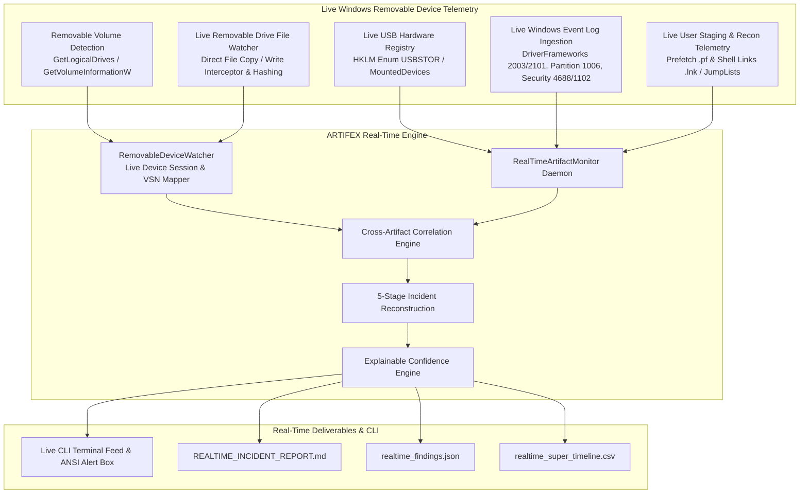

# Real-Time Removable Device Forensic Incident Monitoring & Reconstruction Engine

## Overview
The user requested extending the project to work on real-time incidents for the project **"WINDOWS ARTIFACT ANALYSIS - INSIDER DATA THEFT ANALYSIS"**. Specifically:
- Fully CLI-based with zero GUI.
- Analyze real-time logs and telemetry of removable devices (pendrives, USB storage).
- Chronologically reconstruct data theft events across the 5-stage attack lifecycle in real time.
- Dynamically maintain and export forensic investigation reports (`REALTIME_INCIDENT_REPORT.md`, `realtime_findings.json`, and `realtime_super_timeline.csv`).
- Complete the half-done implementation and seamlessly integrate it into the master CLI and interactive console.

---

## Architecture & Real-Time Removable Device Telemetry



---

## Proposed Changes

### 1. Real-Time Removable Device Watcher & Log Collector
#### [NEW] [realtime_monitor.py](file:///d:/%23PROJECT/ARTIFEX_17nov%282%29/ARTIFEX/insider_forensics/realtime_monitor.py)
Re-engineer and complete `realtime_monitor.py` into a robust, high-performance real-time daemon:
- **Removable Drive Discovery & VSN Tracking:**
  - Query Windows volume API (`GetLogicalDrives`, `GetDriveTypeW`, `GetVolumeInformationW`) for drives with type `DRIVE_REMOVABLE` (or external fixed disks).
  - Extract Drive Letter (e.g., `E:\`), Volume Label, Volume Serial Number (VSN, 8 hex chars), and File System (FAT32, exFAT, NTFS).
  - Map Drive Letter & VSN to physical USB hardware identifiers (`USBSTOR` vendor, product, and hardware serial).
- **Removable Drive Real-Time File Activity & Exfiltration Tracking:**
  - Automatically detect and monitor any mounted removable drives for newly written/copied files.
  - Compute SHA-256 and MD5 hashes of exfiltrated files in real time for evidence integrity.
  - Tag files matching staging extensions (`.zip`, `.7z`, `.rar`, `.tar`) and sensitive data extensions (`.docx`, `.xlsx`, `.pdf`, `.sql`, `.key`, `.py`, etc.).
- **Live Windows Event Log Ingestion (`wevtutil` / Win32 API):**
  - Monitor `Microsoft-Windows-DriverFrameworks-UserMode/Operational` (Events 2003, 2004, 2010, 2101, 2102) for PnP hardware arrival/ejection.
  - Monitor `Microsoft-Windows-Partition/Diagnostic` (Event 1006) for partition table mounting.
  - Monitor `Microsoft-Windows-Storage-ClassPnP/Operational` (Event 507) for disk arrival.
  - Monitor `Security` (Event 4688 for staging commands/CLI copy, Event 1102 for audit clearing) and `System` (Event 104 for log clearing).
- **Live User Artifact Polling:**
  - Prefetch directory (`C:\Windows\Prefetch\*.pf`) for staging tool execution.
  - Recent files (`%APPDATA%\Microsoft\Windows\Recent\*.lnk` & JumpLists) for file access and VSN correlation.
- **Simulation Mode (`--simulate`):**
  - Include an automated real-time incident simulator that simulates a removable USB drive insertion, staging archive creation, file copy to the USB drive, and anti-forensic log clearing—allowing instant demonstration and verification even when a physical USB drive is not currently plugged in.

---

### 2. Event Correlation & 5-Stage Reconstruction in Real Time
#### [MODIFY] [reconstruction.py](file:///d:/%23PROJECT/ARTIFEX_17nov%282%29/ARTIFEX/insider_forensics/correlation/reconstruction.py)
- Ensure direct file transfer events detected on removable drives in real time are categorized as `CONFIRMED` under `DATA_TRANSFER` (backed by both file-watcher observation and VSN linkage).
- Enhance the reconstruction summary to clearly display the removable device serial number, drive letter, volume label, and list of exfiltrated files with file sizes and SHA-256 hashes.

---

### 3. Dynamic Report Maintenance
#### [MODIFY] [reporters/markdown_reporter.py](file:///d:/%23PROJECT/ARTIFEX_17nov%282%29/ARTIFEX/insider_forensics/reporters/markdown_reporter.py)
- Support real-time report generation:
  - Generate and update `REALTIME_INCIDENT_REPORT.md` dynamically on every alert or batch.
  - Provide a dedicated "Removable Device Exfiltration Dossier" table showing device details (Vendor, Model, Serial, Drive Letter, VSN) and all transferred files with cryptographic hashes.
  - Maintain chain-of-custody hashes for all recorded events.

---

### 4. CLI & Interactive Console Integration
#### [MODIFY] [cli.py](file:///d:/%23PROJECT/ARTIFEX_17nov%282%29/ARTIFEX/cli.py) & [insider_forensics/cli.py](file:///d:/%23PROJECT/ARTIFEX_17nov%282%29/ARTIFEX/insider_forensics/cli.py)
- Implement `watch` (and `realtime`) command in `cli.py` with arguments:
  - `--interval` (polling interval in seconds, default: 2.0s)
  - `--threshold` (alert confidence threshold, default: 0.70)
  - `--output` (directory for live incident reports, default: `./realtime_alerts`)
  - `--simulate` (flag to run an authentic live incident simulation for testing/demo)
- Wire up clean ANSI terminal status and banner with continuous real-time incident event stream.

#### [MODIFY] [console.py](file:///d:/%23PROJECT/ARTIFEX_17nov%282%29/ARTIFEX/console.py) & [insider_forensics/console.py](file:///d:/%23PROJECT/ARTIFEX_17nov%282%29/ARTIFEX/insider_forensics/console.py)
- Add `do_watch`, `do_realtime`, `do_monitor` commands to the interactive REPL.
- Enable tab auto-completion for `watch` options.

---

### 5. Automated Test Suite & Documentation
#### [NEW] [test_suite/test_realtime_monitor.py](file:///d:/%23PROJECT/ARTIFEX_17nov%282%29/ARTIFEX/test_suite/test_realtime_monitor.py)
- Unit tests verifying:
  - Removable drive detection and VSN mapping.
  - Real-time removable device log extraction.
  - 5-stage reconstruction of real-time events.
  - Real-time report generation and non-repudiation hashing.
#### [MODIFY] [README.md](file:///d:/%23PROJECT/ARTIFEX_17nov%282%29/ARTIFEX/README.md) & [HOW_TO_RUN.md](file:///d:/%23PROJECT/ARTIFEX_17nov%282%29/ARTIFEX/HOW_TO_RUN.md)
- Update documentation with the new Real-Time Removable Device Monitoring CLI commands and examples.

---

## Verification Plan

### Automated Tests
- Run full test suite using Python Launcher:
  ```powershell
  py -3 -m unittest discover -s test_suite -p "test_*.py"
  ```
- Run the dedicated real-time test suite:
  ```powershell
  py -3 -m unittest test_suite/test_realtime_monitor.py
  ```

### Manual Verification
- Execute live CLI real-time monitor command:
  ```powershell
  py -3 cli.py watch --output ./realtime_incident_report --simulate
  ```
- Verify:
  1. Terminal displays live event timeline with ANSI color highlighting.
  2. USB device arrival, mounting, and VSN mapping are reported.
  3. Staging and file copy to removable device are captured with SHA-256.
  4. 5-stage incident reconstruction is displayed.
  5. Deliverables are generated: `REALTIME_INCIDENT_REPORT.md`, `realtime_findings.json`, and `realtime_super_timeline.csv`.
